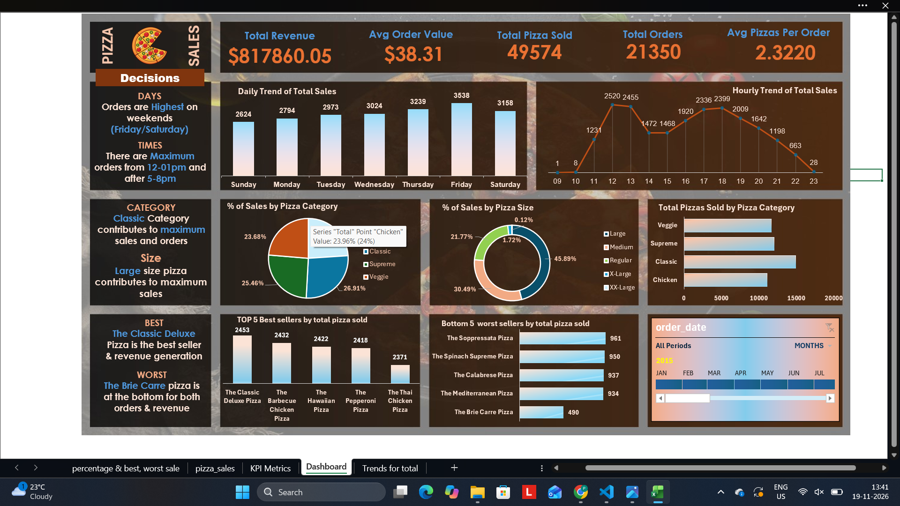

# Pizza Sales Analysis (SQL Server & Microsoft Excel)

An end-to-end data analytics project examining a full year of pizza restaurant sales data (**21,350 orders** | **49,574 pizzas sold** | **$817,860.05 total revenue**). Using **Microsoft SQL Server** for data validation and analytical querying and **Microsoft Excel** for data preprocessing, pivot modeling, and interactive dashboarding, this project uncovers peak ordering periods, top-performing menu categories, and revenue drivers.

---

## 📊 Dashboard Preview



---

## 🎯 Key Performance Indicators (KPIs)

| Metric | Value | Business Definition |
| :--- | :--- | :--- |
| **Total Revenue** | **$817,860.05** | Total sales generated across all pizza orders |
| **Total Orders** | **21,350** | Total distinct customer orders placed |
| **Total Pizzas Sold** | **49,574** | Total quantity of individual pizzas sold |
| **Average Order Value (AOV)** | **$38.31** | Average revenue generated per distinct order (`Total Revenue / Total Orders`) |
| **Average Pizzas Per Order** | **2.32** | Average number of pizzas ordered per transaction (`Total Pizzas Sold / Total Orders`) |

---

## 🛠️ Tech Stack & Workflow

1. **Database Setup & Data Ingestion (SQL Server):**
   * Created the `PizzaSalesDB` database in Microsoft SQL Server and imported the external raw dataset directly into the `pizza_sales` table.
   * Verified row counts, data types, and baseline totals before running analytical queries.
2. **SQL Exploration & Cross-Validation (`SQL/pizza_sales_queries.sql`):**
   * Wrote SQL queries using aggregate functions (`SUM`, `COUNT(DISTINCT)`), date/time functions (`DATENAME`, `DATEPART`), subqueries, and `TOP N` filtering to compute KPIs, daily/hourly order trends, category/size revenue shares, and best/worst-selling items.
   * Cross-checked SQL outputs directly against Excel dashboard figures to ensure complete accuracy.
3. **Excel Connection & Data Preprocessing (`Pizza_Sales_Analysis.xlsx`):**
   * Connected Microsoft Excel directly to the local SQL Server instance (`localhost` → `PizzaSalesDB`) and loaded the `pizza_sales` table.
   * **Data Cleaning:** Standardized pizza size codes (`S` → `Regular`, `M` → `Medium`, `L` → `Large`, `XL` → `X-Large`, `XXL` → `XX-Large`) for clear executive reporting.
   * **Feature Engineering (Order Day):** Extracted the weekday name from `order_date` to support daily order trend analysis.
   * **Distinct Order Counting (`1/COUNTIF`):** Because multi-item orders span multiple rows in the transactional table, added a helper column using `=1/COUNTIF([order_id], [@order_id])` so Pivot Tables accurately sum distinct orders (`21,350`) without double-counting.
4. **KPI Verification & Interactive Dashboarding:**
   * Recomputed all 5 KPIs in Excel and cross-checked them against SQL Server outputs to confirm 100% accuracy.
   * Built Pivot Tables and charts for each analytical dimension and assembled an interactive dashboard featuring an **`order_date` Timeline Slicer** to filter performance dynamically across months.

---

## 🔍 Key Business Insights

* **Peak Days:** Order volume builds steadily toward the weekend, peaking on **Friday (3,538 orders)**, **Thursday (3,239 orders)**, and **Saturday (3,158 orders)**, while **Sunday (2,624 orders)** records the lowest traffic.
* **Peak Hours:** Ordering surges during two distinct windows—**lunchtime (12:00 PM – 1:00 PM)** with over 2,520 orders at noon, and **dinner/evening (5:00 PM – 8:00 PM)**.
* **Category Performance:** The **Classic** category leads both total revenue share (**26.91%**) and total pizzas sold, followed closely by **Supreme (25.46%)**, **Chicken (23.96%)**, and **Veggie (23.68%)**.
* **Size Preference:** **Large** pizzas dominate sales (**45.89%** of revenue), followed by **Medium (30.49%)** and **Regular (21.77%)**, whereas **X-Large (1.72%)** and **XX-Large (0.12%)** contribute minimal volume.
* **Top & Bottom Performers:**
  * **Best Sellers:** *The Classic Deluxe Pizza* (2,453 sold), *The Barbecue Chicken Pizza* (2,432 sold), and *The Hawaiian Pizza* (2,422 sold) lead unit sales.
  * **Underperformers:** *The Brie Carre Pizza* (490 sold) significantly trails all other menu items in both order volume and revenue.

---

## 📁 Repository Structure

```text
Pizza-Sales-Analysis/
├── SQL Query/
│   └── pizza_sales_queries.sql        # All SQL Server KPI and trend analysis queries
├── Dashboard/
│   └── Dashboard_preview.png          # High-resolution screenshot of the Excel dashboard
├── pizza_sales_analysis.xlsx          # Complete workbook (Raw_Data, KPIs, Sales_Trends, Sales_Performance, Dashboard)
└── README.md                          # Project overview, KPIs, workflow, and key insights
```
